# OOBB version 5

AI-generated images and instructions. Errors possible.

## Summary

OOBB version 5 provides parametric, 3D-printable parts for modular mounting and mechanical projects: plates, brackets, bearing holders, gears and complete mechanisms. This repository is the shared Python/OpenSCAD generator and the starting point for finding the separate project catalogues.

This is an entirely AI-generated coding project. The generated outputs are included and usually work, but the main purpose of publishing it is to give others a starting point for modifying the project with their own AI tools.

[Browse the projects below](#details), or open the [generator and component guide](README_GENERATOR.md) to make or modify parts.

[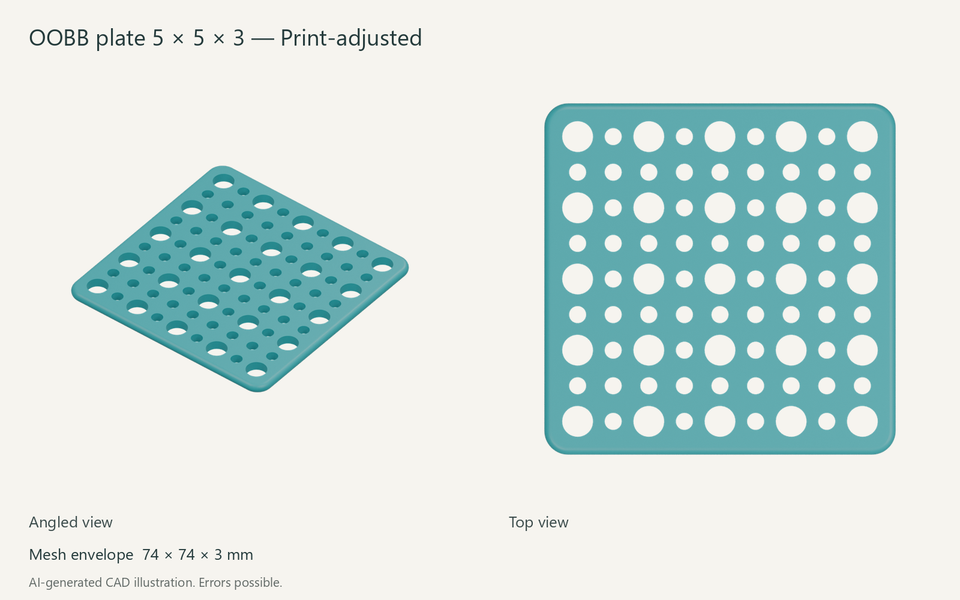](https://github.com/oomlout/oomlout_oobb_part_plate_version_5/tree/main/parts/oobb_part_plate_basic_5_width_5_height_3_depth/)

A [5 by 5 OOBB plate, 3 mm thick](https://github.com/oomlout/oomlout_oobb_part_plate_version_5/tree/main/parts/oobb_part_plate_basic_5_width_5_height_3_depth/), with a 74 by 74 mm outer envelope. The sheet shows the print-adjusted model.

## Details

### Published projects

Choose a project name or thumbnail for its overview and build instructions, or use the last column to go straight to its part folders. Each preview shows one representative example. Public links checked on 14 November 2026.

| Project | What it provides | Find a part |
| --- | --- | --- |
| [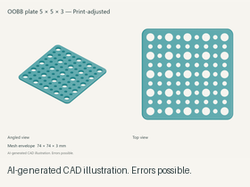](https://github.com/oomlout/oomlout_oobb_part_plate_version_5) [Flat plates](https://github.com/oomlout/oomlout_oobb_part_plate_version_5) | General mounting and prototyping plates. | [Browse variants](https://github.com/oomlout/oomlout_oobb_part_plate_version_5/tree/main/navigation_oobb/oobb/part/plate/basic/) |
| [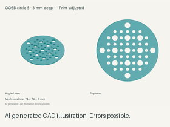](https://github.com/oomlout/oomlout_oobb_part_plate_circle_version_5) [Circle plates](https://github.com/oomlout/oomlout_oobb_part_plate_circle_version_5) | Circular mounting plates in several diameters. | [Browse variants](https://github.com/oomlout/oomlout_oobb_part_plate_circle_version_5/tree/main/navigation_oobb/oobb/part/plate/circle/) |
| [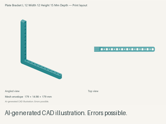](https://github.com/oomlout/oomlout_oobb_part_plate_l_version_5) [L plates](https://github.com/oomlout/oomlout_oobb_part_plate_l_version_5) | Upright brackets, L plates and angle variants. | [Browse variants](https://github.com/oomlout/oomlout_oobb_part_plate_l_version_5/tree/main/navigation_oobb/oobb/part/) |
| [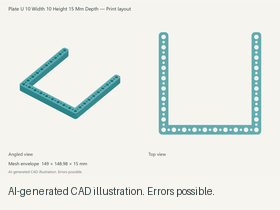](https://github.com/oomlout/oomlout_oobb_part_plate_u_version_5) [U plates](https://github.com/oomlout/oomlout_oobb_part_plate_u_version_5) | U-shaped plates for mounting around an opening. | [Browse variants](https://github.com/oomlout/oomlout_oobb_part_plate_u_version_5/tree/main/navigation_oobb/oobb/part/plate_u/) |
| [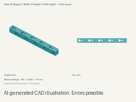](https://github.com/oomlout/oomlout_oobb_part_plate_90_degree_version_5) [90-degree plates](https://github.com/oomlout/oomlout_oobb_part_plate_90_degree_version_5) | Plates for perpendicular mounting. | [Browse variants](https://github.com/oomlout/oomlout_oobb_part_plate_90_degree_version_5/tree/main/navigation_oobb/oobb/part/plate_90_degree/1_width/) |
| [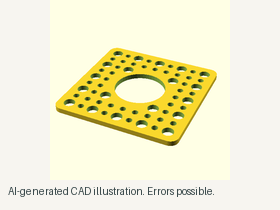](https://github.com/oomlout/oomlout_oobb_part_plate_cutout_version_5) [Plate cutouts](https://github.com/oomlout/oomlout_oobb_part_plate_cutout_version_5) | Plates with circular openings; a printable 30 mm demo and a wider source catalogue. | [Browse parts](https://github.com/oomlout/oomlout_oobb_part_plate_cutout_version_5/tree/main/parts/) |
| [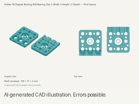](https://github.com/oomlout/oomlout_oobb_part_holder_bearing_version_5) [Bearing holders](https://github.com/oomlout/oomlout_oobb_part_holder_bearing_version_5) | Mounts selected by bearing size and holder style. | [Browse variants](https://github.com/oomlout/oomlout_oobb_part_holder_bearing_version_5/tree/main/navigation_oobb/oobb/part/) |
| [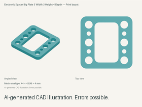](https://github.com/oomlout/oomlout_oobb_electronic_version_5) [Electronic parts](https://github.com/oomlout/oomlout_oobb_electronic_version_5) | Spacers and mounting parts for electronics. | [Browse variants](https://github.com/oomlout/oomlout_oobb_electronic_version_5/tree/main/navigation_oobb/oobb/part/electronic/) |
| [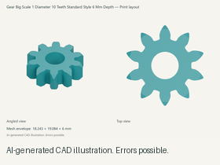](https://github.com/oomlout/oomlout_oobb_gear_version_5) [Gears](https://github.com/oomlout/oomlout_oobb_gear_version_5) | Standard, flange, split, bearing and bevel variants. | [Browse variants](https://github.com/oomlout/oomlout_oobb_gear_version_5/tree/main/navigation_oobb/oobb/part/gear/) |
| [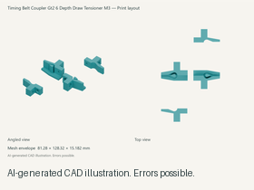](https://github.com/oomlout/oomlout_oobb_part_timing_pulley_version_5) [Timing pulleys and couplers](https://github.com/oomlout/oomlout_oobb_part_timing_pulley_version_5) | Belt pulleys, idlers, couplers and tensioners. | [Browse variants](https://github.com/oomlout/oomlout_oobb_part_timing_pulley_version_5/tree/main/navigation_oobb/oobb/part/) |
| [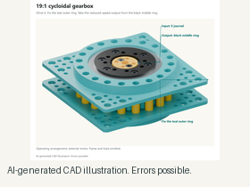](https://github.com/oomlout/oomlout_oobb_part_motor_gearbox_cycloidal_version_5) [Cycloidal gearbox](https://github.com/oomlout/oomlout_oobb_part_motor_gearbox_cycloidal_version_5) | A printable reduction mechanism with an illustrated assembly guide. | [Open V2 parts](https://github.com/oomlout/oomlout_oobb_part_motor_gearbox_cycloidal_version_5/tree/main/parts/oobb_part_motor_gearbox_cycloidal_simple_double_bearing_version_2_20_to_1_reduction/) |

The refreshed catalogues use text-only navigation. Follow the size or variant choices to a canonical part folder containing its README, metadata, CAD and available printable files. Width and height may be OOBB grid units rather than millimetres; use the selected project's dimensions and print instructions.

### Using the generator

The [generator and component guide](README_GENERATOR.md) covers installation, the component library, preview generation, documentation commands and the current development setup. Start with its [component reference](README_GENERATOR.md#component-reference) when choosing shapes, holes or fastener cutouts.

### Local projects

These projects are present in the development workspace and do not yet have verified public pages with downloadable content. Open the [local project locations](README_GENERATOR.md#local-projects) for their folder names and status.

| Project | Example shown |
| --- | --- |
| [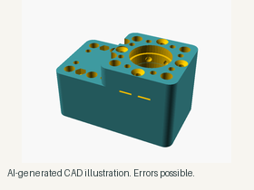](README_GENERATOR.md#local-projects) Motor holders | Printed TT motor-holder assembly. |
| [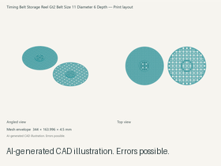](README_GENERATOR.md#local-projects) Timing-belt storage | GT2 belt storage reel. |
| [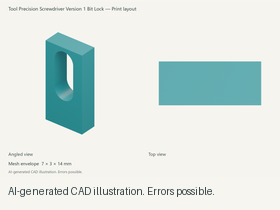](README_GENERATOR.md#local-projects) Precision screwdriver | Version-one bit-lock component. |
| [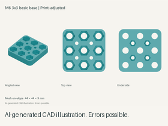](README_GENERATOR.md#local-projects) Captive-nut plates | 3 by 3 M6 plate base. |

## Parts

The thumbnails show existing CAD previews from each project, reduced for this index. The bearing-holder preview is a print layout, and the plate-cutout preview shows a 30 mm opening; use each project's full-size images and part metadata for details.

Hardware requirements belong to the selected project and variant. For the cycloidal gearbox, use its [hardware list](https://github.com/oomlout/oomlout_oobb_part_motor_gearbox_cycloidal_version_5#parts) and [complete parts manifest](https://github.com/oomlout/oomlout_oobb_part_motor_gearbox_cycloidal_version_5/blob/main/presentation/parts.csv).

## Assembly

Open the chosen part folder and follow its print preparation and assembly instructions. Multipart projects specify their own bearings, fasteners, fit adjustments and assembly order; the gearbox includes an [illustrated sequence](https://github.com/oomlout/oomlout_oobb_part_motor_gearbox_cycloidal_version_5#assembly) and an [assembly manual](https://github.com/oomlout/oomlout_oobb_part_motor_gearbox_cycloidal_version_5/blob/main/presentation/assembly-guide.pdf).

To create documentation for another OOBB project, use the [presentation workflow](presentation/README.md), [technical style](presentation/STYLE.md) and [render style](RENDER_STYLE.md). For a part catalogue, follow the [compact catalogue standard](presentation/CATALOGUE_REFRESH.md).
