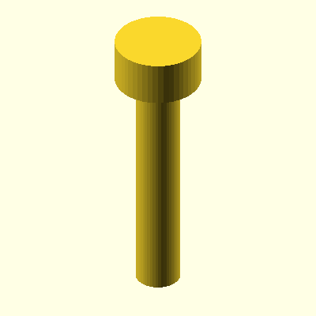
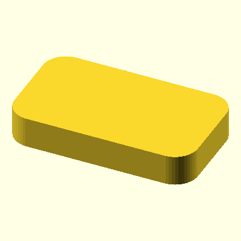

# OOBB generator and components

AI-generated images and instructions. Errors possible.

[Back to the OOBB version 5 projects](README.md)

This guide covers the shared Python/OpenSCAD generator, its reusable components and the commands for generating previews and component documentation. For ready-made parts and project-specific build instructions, use the [project index](README.md#details).

This is an entirely AI-generated coding project. The generated outputs are included and usually work, but the main purpose of publishing it is to give others a starting point for modifying the project with their own AI tools.

For presentation colours, assembly views and exploded diagrams, see the [OOBB render style guide](RENDER_STYLE.md).

For catalogue renders and linked parts tables, add this folder to PATH and run `oobb-present` from a breakout part folder, or `oobb-present --all` from its repository root. See the [catalogue presentation workflow](presentation/CATALOGUE.md).

For the newer compact OOBB catalogue style, use the [catalogue refresh standard](presentation/CATALOGUE_REFRESH.md): folder links, text-only navigation, canonical studio renders, generator repairs and validated regeneration. The [project rollout notes](presentation/CATALOGUE_REFRESH_PROJECTS.md) identify the first targets; the [Git reset procedure](presentation/CATALOGUE_HISTORY_RESET.md) covers an authorized clean-history restart. These are implementation instructions; the existing `oobb-present` adapter has not yet been converted to this style.

This is a development checkout of the OOBB generator. It contains the Python/OpenSCAD tooling, component definitions, dimensional data, generated previews, and migration scaffolding used to build and document OOBB geometry.

## Component reference

Browse the [component library](components/) for the complete list of shapes and helpers. Each component folder contains its parameter documentation and `working.py` implementation; generated samples live in its `test/` folder.

| Task | Components |
| --- | --- |
| Make a plate or round mounting surface | [oobb_plate](components/oobb_plate/), [oobb_circle](components/oobb_circle/) |
| Add mounting holes | [oobb_holes](components/oobb_holes/), [oobe_holes](components/oobe_holes/), [oobb_hole](components/oobb_hole/) |
| Add fastener clearances | [oobb_screw](components/oobb_screw/), [oobb_nut](components/oobb_nut/) |
| Build basic geometry | [oobb_cylinder](components/oobb_cylinder/), [rounded_rectangle](components/rounded_rectangle/) |
| Add mechanical features | [oobb_bearing](components/oobb_bearing/), [oobb_gear_spur](components/oobb_gear_spur/) |

These are generator building blocks. Finished printable designs live in the separate [project catalogues](README.md#details).

## What This Repo Is For

- Developing and tuning OOBB geometry and fastener/component helpers
- Discovering components from per-folder `working.py` files under `components/`
- Rendering OpenSCAD outputs and preview images
- Generating JSON, HTML, and Markdown documentation for components
- Keeping migration and regression tests around while the codebase is being restructured

## What This Repo Contains

- Core runtime modules such as `oobb.py`, `opsc.py`, and `oobb_variables.py`
- `components/` with 60+ component folders, each centered on a `working.py`
- Generated per-component docs such as `components/*/README.md` and `components/*/documentation_detail.html`
- Test coverage under `tests/` plus generated test artifacts in `tests/test_runs/`
- CSV-backed reference data in `data/oring/`
- Archived legacy code and migration notes in `old/`

## Quick Tour

- [`oobb.py`](./oobb.py): main OOBB runtime, variable access, dispatch, and part-building helpers
- [`opsc.py`](./opsc.py): OpenSCAD/SolidPython rendering pipeline and image generation helpers
- [`oobb_variables.py`](./oobb_variables.py): shared dimensional data, tolerances, screw sizes, bearings, and mode-specific values
- [`components/`](./components/): component library, per-component docs, tests, and discovery-based tooling
- [`components/documentation.py`](./components/documentation.py): exports JSON/HTML/Markdown documentation
- [`components/run_tests.py`](./components/run_tests.py): per-folder object/set test runner
- [`components/generate_all_component_tests.py`](./components/generate_all_component_tests.py): regenerates component preview assets
- [`templates/`](./templates/): documentation templates used by the batch scripts
- [`data/`](./data/): supporting data, including O-ring CSV tables and sample architecture experiments
- [`tests/`](./tests/): regression tests, snapshots, and generated reports
- [`old/`](./old/): archived code, migration helpers, and the current `oobb_arch` compatibility path

## Installation / Setup

Setup is currently manual.

Run these commands from this repository's root folder:

```powershell
python -m venv .venv
.venv\Scripts\Activate.ps1
python -m pip install --upgrade pip
python -m pip install -r requirements.txt
```

Also install OpenSCAD and make sure `openscad` or `openscad.com` is available on `PATH`.

Notes:

- The rendering pipeline in [`opsc.py`](./opsc.py) shells out to OpenSCAD for `.scad` and preview image generation.
- Some older scripts appear to expect adjacent local tooling or paths, including OOMP/`oomB`, generated-parts repos, and Windows-specific absolute paths.
- The component/documentation system currently imports `oobb_arch` from [`old/`](./old/), which is intentional in this repo state.

## Generate a component preview

After setup, run the plate component's existing sample generator from the repository root:

```powershell
python -c "from components.oobb_plate import working; working.test()"
```

This writes SCAD and preview images beneath `components/oobb_plate/test/`, including a plain plate and a plate with holes. It refreshes the sample files; it does not build a downstream project's catalogue. Read the [plate parameters](components/oobb_plate/) and its [sample definitions](components/oobb_plate/working.py) to change dimensions or hole options.

To run the discovered component tests, including their render work, expose the repository root and the legacy `oobb_arch` compatibility package to Python:

```powershell
$env:PYTHONPATH = "$PWD;$PWD\old;$env:PYTHONPATH"
python components/run_tests.py --objects-only --objects-root components
```

For finished project regeneration, follow that project's build guide. Build entry points and OpenSCAD/native CAD requirements vary between repositories.

## Examples

Representative preview images already checked into the repo:

### `oobb_screw`



### `rounded_rectangle`



More examples live under `components/*/test/`.

## Documentation Generation

Documentation output is generated into:

- [`components/documentation_data.json`](./components/documentation_data.json)
- [`components/documentation.html`](./components/documentation.html)
- per-component `README.md` files under `components/*/`
- per-component `documentation_detail.html` files under `components/*/`

To regenerate documentation using existing previews, run from the repository root:

```powershell
python components/documentation.py --objects-root components --json components/documentation_data.json --html-template templates/oobb_documentation_template.html --html-output components/documentation.html --markdown
```

To generate missing component previews before updating the docs:

```powershell
python components/generate_all_component_tests.py --objects-root components --skip-existing-images
```

Omit `--skip-existing-images` when intentionally rebuilding previews after geometry changes. The flag checks for existing image files, not source changes.

The Windows [standard batch command](action_documentation_regenerate.bat) generates missing previews and then documentation. The [all batch command](action_documentation_regenerate_all.bat) generates docs before and after that preview pass. Both use `--skip-existing-images`. Component index READMEs and HTML/JSON outputs are regenerated; existing per-component READMEs are retained by the Markdown exporter.

## Local projects

Checked on 14 November 2026. These folders are siblings of this repository in the development workspace; their paths are local checkout locations, not public download links.

| Project | Folder beside this checkout | Availability |
| --- | --- | --- |
| Motor holders | `oomlout_oobb_part_holder_motor_version_5/` | Local TT, servo and NEMA work; no Git remote configured. |
| Timing-belt storage | `oomlout_oobb_part_timing_belt_storage_version_5/` | Local storage-reel catalogue; no Git remote configured. |
| Precision screwdriver | `oomlout_oobb_tool_precision_screwdriver_version_5/` | Local components, fit samples and assembly notes; no Git remote configured. |
| Captive-nut plates | `oomlout_oobb_part_plate_captive_nut_version_5/` | Local two-piece plates; configured GitHub repository is private and its README was unavailable during this check. |

Open each available local folder to read its project documentation. Publicly browsable projects are linked from the [main README](README.md#details).

## Related Repositories

- [`oomlout/oomlout_oomp_version_5`](https://github.com/oomlout/oomlout_oomp_version_5): appears to be related OOMP data/tooling used elsewhere in the Oomlout stack
- [`oomlout/oomlout_roboclick`](https://github.com/oomlout/oomlout_roboclick): related automation/action repo; this repo includes `data/sample architecture/` material that references RoboClick-style actions

## Notes / Current State

- This repo is mid-transition from older generator code to a per-component discovery architecture.
- `old/` is not just archive material; some live compatibility imports still come from there.
- A few scripts still contain hard-coded Windows paths or references to older generated-parts repositories.
- Some generated `.scad` test artifacts contain absolute include paths, so this repo is best treated as a developer/workshop environment rather than a clean portable package.
