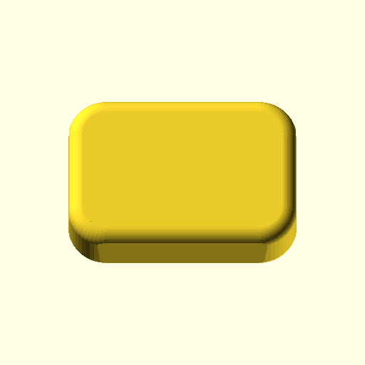

# oobb_rounded_rectangle_rounded_draft_angle

**OOBB Geometry Primitives: Rounded Rectangle with Draft Angle**

Rounded rectangle with rounded top and bottom edges. `size` gives the undrafted reference envelope at the top. A positive `draft_angle` tapers the side walls inward toward the bottom, matching a part modeled upside down relative to the mould. The nominal full-depth width and height reduction is `2 × depth × tan(draft_angle)`; rounded edges affect the exact face dimensions.

## Variables

| Name | Description | Type | Default |
|------|-------------|------|---------|
| pos | 3-element [x,y,z] position. | list | [0,0,0] |
| type | Geometry type: p/positive or n/negative. | string | p |
| size | Overall [x,y,z] dimensions of the undrafted reference shape at the top, in mm. | list | [20,10,5] |
| radius | Corner radius of the base shape. | number | 5 |
| radius_rounded | Rounding radius for top/bottom edges. | number | 2.5 |
| draft_angle | Side-wall draft angle in degrees. Positive values taper the bottom inward relative to the top. | number | 1 |
| extra | Extra variant/modifier string. | string | "" |
| rot | Rotation [rx,ry,rz] in degrees. | list | [0,0,0] |
| rot_x | X rotation in degrees. | number | 0 |
| rot_y | Y rotation in degrees. | number | 0 |
| rot_z | Z rotation in degrees. | number | 0 |

## Draft size change

The table shows nominal full-depth width and height reduction for an ideal drafted wall. Each bottom side moves inward by half the tabulated amount. Values are calculated as `2 × depth × tan(angle)` and rounded to 0.001 mm. The component keeps the rounded top and bottom edges, so its exact face dimensions also depend on `radius_rounded`.

| Depth (mm) | 0° | 0.5° | 1° | 2° | 3° | 5° |
|------------|----:|-----:|----:|----:|----:|----:|
| 3 | 0.000 | 0.052 | 0.105 | 0.210 | 0.314 | 0.525 |
| 5 | 0.000 | 0.087 | 0.175 | 0.349 | 0.524 | 0.875 |
| 10 | 0.000 | 0.175 | 0.349 | 0.698 | 1.048 | 1.750 |
| 20 | 0.000 | 0.349 | 0.698 | 1.397 | 2.096 | 3.499 |
| 25 | 0.000 | 0.436 | 0.873 | 1.746 | 2.621 | 4.374 |

## Previews

| Draft angle | Preview |
|-------------|---------|
| 0° |  |
| 1° |  |
| 5° |  |
